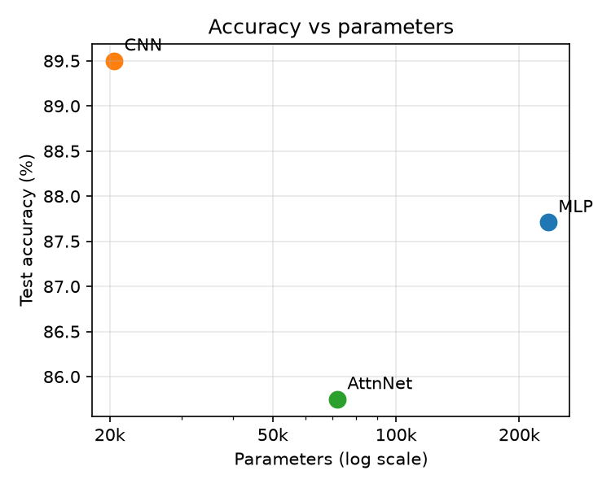
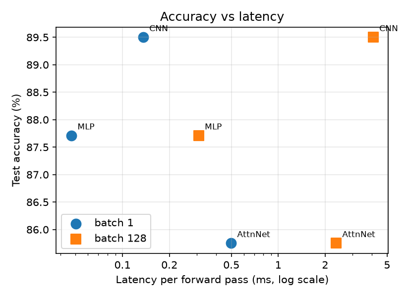

# Lab 3: Architectures and their costs

## 1. Setup

- Dataset: Fashion-MNIST (`torchvision.datasets.FashionMNIST`), `ToTensor()` + `Normalize((0.2860,), (0.3530,))`.
- Split: official train 60k -> 55k train / 5k validation (seed 42); official 10k test set. Batch size 128.
- Training: Adam, lr 1e-3, 5 epochs, seed 42 (same seed for every model).
- Latency: CPU, `model.eval()`, `torch.no_grad()`, median of 100 timed runs after 20 warm-up runs, batch 1 and batch 128.
- Machine: TODO (CPU model, OS, PyTorch version 2.15.0, Python 3.11).
- Code: `lab3.py`. All numbers below come from one run of it.

### Deviations and notes

- **Parameter target.** The lab asks for models of 100k-150k parameters, but the specified architectures give 235k (MLP), 20k (CNN) and 72k (attention). I implemented them exactly as written rather than resizing them.
- **Positional embedding.** The attention model includes a learned positional embedding (16 x 64 = 1,024 parameters), which the lab text does not mention. Without it, mean pooling would ignore the order of the patches. This is why the model has 71,818 parameters instead of 70,794.

## 2. Results

| Model | Params | Hand FLOPs | thop FLOPs (MACs x 2) | Latency b=1 (ms) | Latency b=128 (ms) | Test accuracy |
|---|---|---|---|---|---|---|
| MLP | 235,146 | 469,504 | 469,504 | TODO | TODO | 87.71% |
| CNN | 20,490 | 2,063,488 | 2,063,488 | TODO | TODO | 89.50% |
| Attention | 71,818 | 2,329,856 | 1,182,976 | TODO | TODO | 85.75% |

Latency varies between runs on a laptop CPU (for example, the MLP at batch 128 measured 0.29 to 0.61 ms across my runs), so the table uses the values printed by the same run that produced the plots. FLOPs, parameters and accuracy are identical between runs (seeded).

Parameter counts from `torchinfo.summary` match my manual `sum(p.numel())`. Screenshots of the three summaries are in `screenshots/`.

Validation accuracy after each epoch:

| Epoch | MLP | CNN | Attention |
|---|---|---|---|
| 1 | 0.8436 | 0.8648 | 0.8014 |
| 2 | 0.8510 | 0.8786 | 0.8208 |
| 3 | 0.8748 | 0.8928 | 0.8466 |
| 4 | 0.8832 | 0.8876 | 0.8552 |
| 5 | 0.8782 | 0.8986 | 0.8594 |

## 3. Hand FLOP calculations

Convention: FLOPs = 2 x MACs, per single 28x28 image, using the Chapter 4 formulas. Biases, ReLU, pooling, softmax and LayerNorm are not counted.

### One layer of each type

**Linear (MLP, 784 -> 256):**
FLOPs = 2 x in x out = 2 x 784 x 256 = **401,408**.
Params = 784 x 256 + 256 = 200,960.

**Conv2d (CNN, Conv2d(16, 32, 3, padding=1), output 32 x 14 x 14):**
FLOPs = 2 x K x K x C_in x C_out x H_out x W_out = 2 x 3 x 3 x 16 x 32 x 14 x 14 = **1,806,336**.
Params = 3 x 3 x 16 x 32 + 32 = 4,640.

**Attention (one encoder layer, seq = 16, d_model = 64, dim_feedforward = 128):**

| Part | Formula | FLOPs |
|---|---|---|
| QKV projections | 2 x seq x d x 3d = 2 x 16 x 64 x 192 | 393,216 |
| Scores QK^T | 2 x seq^2 x d = 2 x 256 x 64 | 32,768 |
| Attention x V | 2 x seq^2 x d | 32,768 |
| Output projection | 2 x seq x d x d = 2 x 16 x 64 x 64 | 131,072 |
| FFN (two linears) | 2 x 16 x 64 x 128 + 2 x 16 x 128 x 64 | 524,288 |
| **Layer total** | | **1,114,112** |

Params for this layer = in-proj 12,480 + out-proj 4,160 + FFN 16,576 + two LayerNorms 256 = 33,472.

### Full-model totals

**MLP:** 401,408 + 65,536 + 2,560 = **469,504**

**CNN:** Conv1 225,792 + Conv2 1,806,336 + Linear (2 x 1568 x 10) 31,360 = **2,063,488**

**Attention:** patch embed (2 x 16 x 49 x 64) 100,352 + 2 encoder layers 2,228,224 + head (2 x 64 x 10) 1,280 = **2,329,856**

## 4. Hand vs measured (thop)

`thop.profile` reports MACs, so I multiplied by 2 to compare with FLOPs.

| Model | Hand | thop (x2) | Match |
|---|---|---|---|
| MLP | 469,504 | 469,504 | Yes |
| CNN | 2,063,488 | 2,063,488 | Yes |
| Attention | 2,329,856 | 1,182,976 | No (gap 1,146,880) |

- **MLP and CNN.** thop counts `Linear` and `Conv2d` as MACs and counts ReLU, MaxPool and Flatten as zero, which is the same set of operations as my formulas, so the values are identical.
- **Attention.** thop has no hook for `nn.MultiheadAttention`, so it does not count the QKV projection, QK^T, attention x V or the output projection inside it. That is 589,824 FLOPs per layer, or 1,179,648 for two layers. It does count the four LayerNorms, which my hand formula ignores; reconciling the totals gives 32,768 FLOPs for them (this figure is derived from the difference, not printed by thop). So the predicted gap is 1,179,648 - 32,768 = 1,146,880, which equals the measured gap. thop still counts the patch embedding, the head and the two FFN linears per layer.

The same reconciliation is in `lab3_hand_calculations.xlsx`.

## 5. Plots

## 6. Which architecture is most cost-effective?

TODO: rewrite this in your own words and check it against your final latency numbers. Draft below.

**Per parameter, the CNN is clearly the most cost-effective.** It reaches the highest test accuracy (89.50%) with the fewest parameters (20k). Convolution reuses the same 3x3 weights at every position and only looks at a local neighborhood (Ch. 4.3), so it encodes the image prior directly. The MLP uses about 11 times more parameters (235k) for about 1.8 points lower accuracy, because every pixel connects to every unit and there is no weight reuse. The attention model sits in between on size (72k) and is the least accurate (85.75%).

**Latency tells a different story, and FLOPs do not predict it.** The CNN has fewer FLOPs than the attention model (2.06M vs 2.33M) but was the slowest at batch 128 in every run, while the MLP was always the fastest. The MLP is made of a few large, regular matrix multiplications with sequential memory access, which a CPU runs efficiently. The CNN's convolutions have small channel counts (16 and 32) on small feature maps, so they perform little arithmetic per byte moved and run at a lower effective throughput (Ch. 4.6-4.7 access patterns). At batch 1 the attention model was the slowest in every run, because it launches many tiny operations (reshape, per-layer attention, softmax, LayerNorm, several linears) and fixed per-operation overhead dominates. Its latency grows less with batch size than the others, since batching amortizes that overhead. Effective throughput check: TODO (FLOPs x batch / latency, from your final numbers).

**Verdict.** If accuracy per parameter or model size matters (memory, storage), the CNN wins. If latency at large batch matters most, the MLP wins, trading about 1.8 points of accuracy for a much faster forward pass. At batch 1, the CNN is close to the MLP in latency and more accurate, so for single-image inference it is the best choice overall. The attention model is dominated here: it is slower than the MLP and less accurate than the CNN at both batch sizes.

**Caveats.** Each model was trained for only 5 epochs with one seed, so differences of about a point could change with more training. The attention model's validation accuracy was still rising (0.80 to 0.86), so it is probably undertrained rather than fundamentally worse. Latency was measured on CPU only, and a GPU would change the ranking at batch 128. Latency varies between runs, so small differences should not be over-interpreted.

## 7. Files

- `lab3.py`: full pipeline (data, models, parameter counts, FLOPs, latency, training, plots)
- `acc_vs_params.png`, `acc_vs_latency.png`: trade-off plots
- `lab3_hand_calculations.xlsx`: hand FLOP and parameter calculations
- `screenshots/`: torchinfo summaries and the final results table
